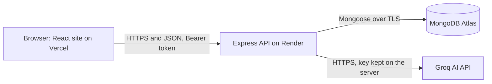

# Hospital Booking System

An AI-assisted appointment booking platform. Patients browse doctors, pick a real open time and book. Doctors confirm or decline from their own dashboard. An assistant suggests which doctor to see, without diagnosing and without booking anything.

**All doctors, patients, ratings and appointments are fictional demo data. Nothing here is medical advice.**

| | |
|---|---|
| Live site | https://hospital-booking-system-zeta-nine.vercel.app |
| Live API health check | https://hospital-booking-system-rx3p.onrender.com/api/health |
| Repository | https://github.com/jacobnyabuto/hospital-booking-system |

> The API runs on a free tier and sleeps after about 15 minutes without traffic. The first request after a quiet period can take up to a minute, and the site shows loading states meanwhile.

## Problem and users

Booking a doctor usually means phone calls, guessing which specialty to choose, and not knowing which times are really free.

| User | What they do |
|---|---|
| Visitor | Browses doctors and open times without an account |
| Patient | Registers, books, reschedules and cancels appointments, uses the assistant |
| Doctor | Sees only their own appointments, confirms, declines, cancels and completes them |

## Features

- Register, log in, log out, and protected pages with separate patient and doctor roles
- Doctor directory with filters by specialty, name and location, plus detailed profiles
- Real 30-minute slots in the clinic time zone (America/Chicago), with double booking prevented by a database rule
- Patient dashboard: counts, upcoming and past appointments, reschedule and cancel
- Doctor dashboard: confirm, decline, cancel and complete, showing the patient's name and reason only
- AI doctor assistant (see below)
- Responsive layout, light and dark themes, keyboard and screen-reader friendly forms

## The AI feature

Describe a concern in plain words and the assistant suggests up to three **real doctors from the database**.

1. The server validates and cleans the text, then checks it against a fixed list of emergency phrases. A match returns an emergency message and **no AI call is made**.
2. Obvious personal identifiers (emails, phone numbers, long ID numbers) are removed.
3. Only the cleaned text and four fields per doctor (id, name, specialty, location) are sent to the AI provider.
4. The reply must be valid JSON. Every doctor id is checked against MongoDB, and anything invented is dropped.
5. If the provider fails or times out, a keyword-based fallback suggests doctors by specialty.

Safeguards: login required, 10 requests per hour per user, 500-character limit, an always-visible disclaimer, and no automatic booking. Results are in `docs/ai-evaluation.md`.

**Limits.** The emergency phrase list is a safety net, not a medical device, and can miss urgent wording. Names and street addresses are not removed before the provider call, so use fictional details. The assistant never diagnoses.

## Screenshots

| Home | Doctors |
|---|---|
|  |  |

| Booking | AI suggestions |
|---|---|
|  |  |

| Patient dashboard | Doctor dashboard |
|---|---|
|  |  |

| Emergency message | Mobile |
|---|---|
|  |  |

## Architecture



Three tiers: the React app never talks to the database or the AI provider. Secrets live only in the API's environment.

## Technology

| Layer | Choice |
|---|---|
| Frontend | React 19, Vite, React-Bootstrap, React Router |
| Backend | Node.js 22, Express 5 |
| Database | MongoDB Atlas with Mongoose |
| Security | bcryptjs, JSON Web Tokens, helmet, CORS with one exact origin, express-rate-limit |
| Dates | luxon, for the clinic time zone |
| AI | Groq API, model openai/gpt-oss-20b |
| Hosting | Vercel (site), Render free tier (API), Atlas free tier (database) |

## Project structure

```
hospital-booking-system/
  client/                React app
    src/components/      cards, forms, slot picker, AI assistant, navbar
    src/pages/           home, doctors, doctor detail, login, register, dashboards
    src/services/        the single API layer and per-feature services
    src/context/         authentication state
    src/hooks/           data fetching, debounce, theme, clock
    public/images/       specialty pictures and background
  server/
    src/config/          database connection
    src/models/          User, Doctor, Appointment
    src/routes/          URL maps
    src/controllers/     request handling
    src/services/        slots, booking rules, AI pipeline
    src/middleware/      auth, errors, rate limits, ID checks
    src/utils/           validation, ownership, tokens
    scripts/             seed script and test scripts
  docs/                  API and AI contracts, test results, security review
```

## Run it locally

**Prerequisites:** Node.js 22 LTS or newer, Git, a free MongoDB Atlas cluster with a database user and your IP allowed, and optionally a Groq API key (without it, the assistant uses its keyword fallback).

```powershell
git clone https://github.com/jacobnyabuto/hospital-booking-system.git
cd hospital-booking-system

# API
cd server
npm ci
Copy-Item .env.example .env      # then fill in your own values
npm run seed                     # creates 6 demo doctors and 1 demo patient (type yes)
npm run dev                      # http://localhost:5000

# Website, in a second terminal
cd client
npm ci
Copy-Item .env.example .env
npm run dev                      # http://localhost:5173
```

### Environment variables (names only, never commit values)

| Where | Names |
|---|---|
| `server/.env` | PORT, NODE_ENV, MONGODB_URI, JWT_SECRET, JWT_EXPIRES_IN, CLIENT_ORIGIN, CLINIC_TIMEZONE, SEED_DOCTOR_PASSWORD, SEED_PATIENT_PASSWORD, AI_PROVIDER, AI_MODEL, AI_API_KEY, AI_TIMEOUT_MS, AI_RATE_LIMIT, AUTH_RATE_LIMIT, APPT_RATE_LIMIT |
| `client/.env` | VITE_API_BASE_URL (a public address, never a secret) |

The seed script refuses to run when `NODE_ENV` is production.

## Demo accounts

On the live site, reviewers can use these fictional accounts. **Passwords are provided in the submission document, not in this public repository.**

| Role | Email |
|---|---|
| Patient | demo.patient@hospital-demo.test |
| Doctors | alan.rivera@, priya.nair@, marcus.bell@, elena.rossi@, samir.haddad@, grace.okoye@ (all hospital-demo.test) |

You can also register your own patient account.

## API summary

Full contract: `docs/api-contract.md` and `docs/hospital-booking.postman_collection.json`.

| Area | Endpoints |
|---|---|
| Health | GET /api/health |
| Auth | POST /api/auth/register, POST /api/auth/login, GET and PATCH /api/auth/me |
| Doctors | GET /api/doctors, GET /api/doctors/:id, GET /api/doctors/:id/slots |
| Appointments | POST, GET /mine, GET /doctor/mine, GET /:id, PATCH /:id, PATCH /:id/status, DELETE /:id under /api/appointments |
| AI | POST /api/ai/recommend-doctor |

Errors always use one shape: `{ "error": "...", "details": [...] }`.

## Testing

From `server`, with a **development** database configured:

```powershell
npm run test:unit     # 7 files: models, validation, slots, ownership, booking rules, AI safety and service
npm run test:live     # 6 files against a running local API
node scripts/test-ai-live.js
```

**Never run these against a production database.** They create and delete data.

Evidence: `docs/test-plan.md` (manual and automated results), `docs/production-test.md` (smoke test on the deployed site), `docs/ai-evaluation.md` (twelve AI cases), `docs/security-review.md`.

## Deployment

| Piece | Setup |
|---|---|
| Database | Atlas, separate production database and a user limited to that database |
| API | Render web service, root directory `server`, build `npm ci`, start `npm start`, health check `/api/health`, Node 22 |
| Site | Vercel, root directory `client`, Vite preset, `VITE_API_BASE_URL` set, SPA rewrite in `client/vercel.json` |
| Link between them | `CLIENT_ORIGIN` on the API equals the exact site address |

## Known limitations

- One clinic time zone, 30-minute slots, no waiting list, no email or SMS reminders
- No real payments, insurance checks, video visits or chat. Ratings are demo data
- The login token is kept in browser storage, which an injected script could read. Tokens last one day, and logging out only removes the token from the browser
- Rate limits are held in memory and reset when the API restarts
- Free-tier hosting: the API sleeps when idle, and Atlas allows shared Render address ranges
- The AI sends cleaned text to a third-party provider, and the emergency phrase list can miss or over-trigger
- Doctor lists are not paginated, which is fine for six doctors

## Future improvements

Email and SMS reminders, real insurance verification and payments, patient reviews, a waiting list, multiple clinic time zones, secure messaging, and pagination.

## Responsible AI statement

The assistant is advisory only. It does not diagnose, prescribe, state availability or prices, or create bookings. Every suggestion is checked against real data, emergency wording bypasses the model, and the interface always reminds users to review a doctor's profile and to call emergency services in an emergency. This is a demonstration, so use fictional details only.

## Author

GitHub: [@jacobnyabuto](https://github.com/jacobnyabuto)
