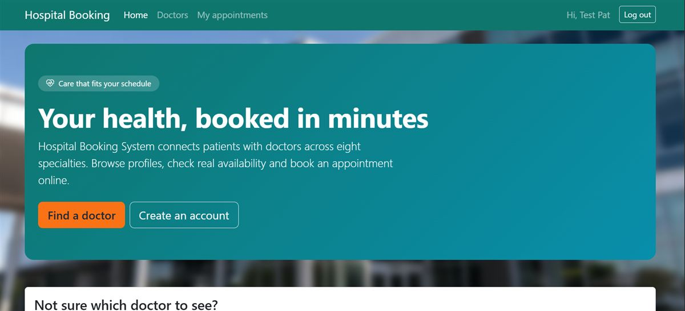
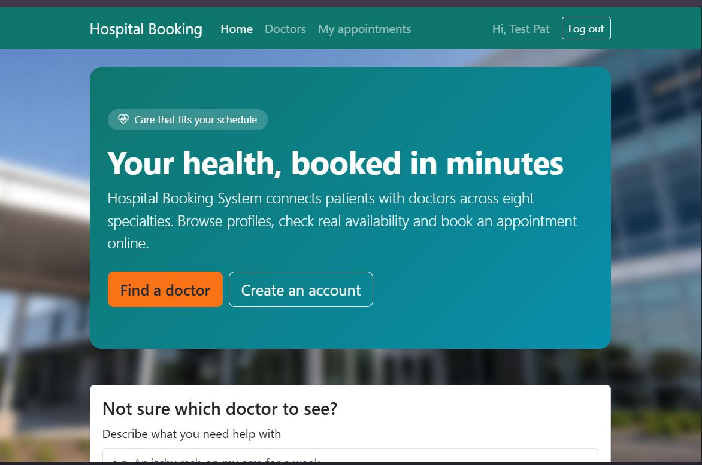
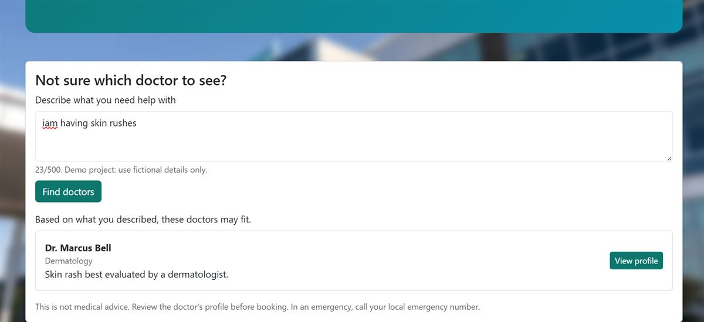
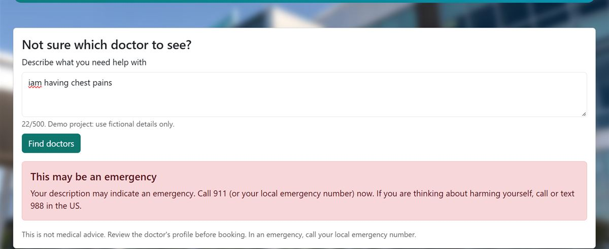
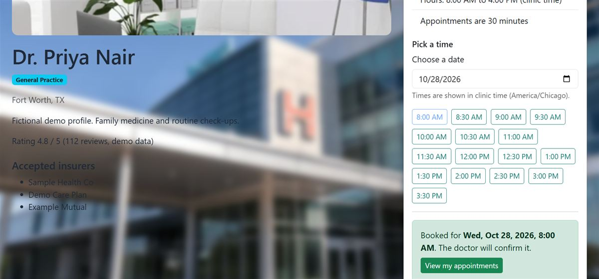
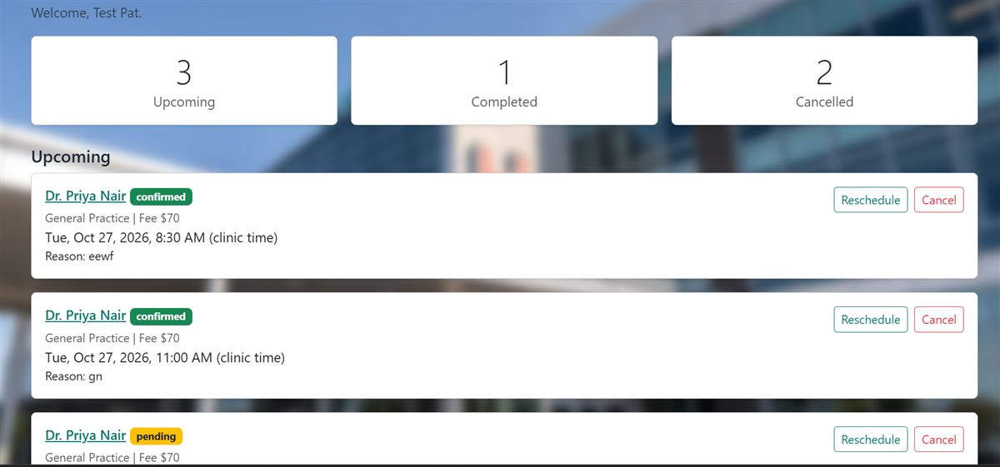
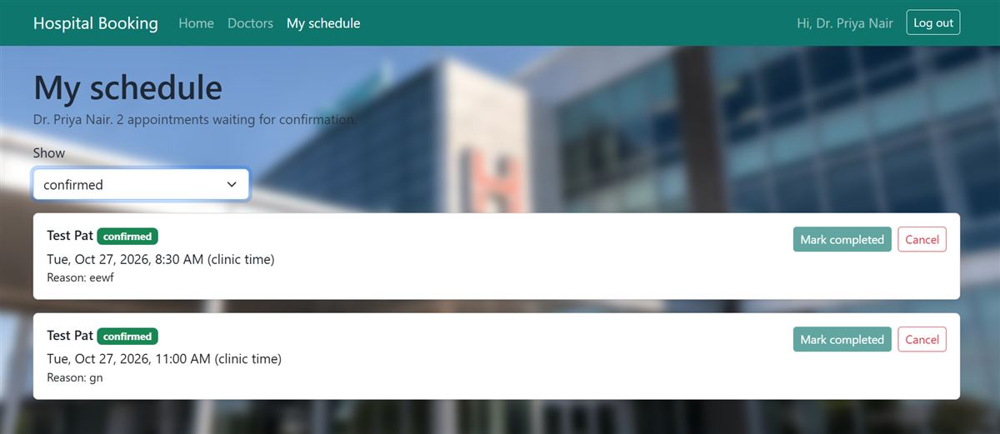
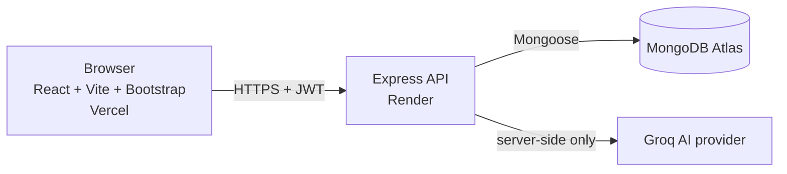

# Hospital Booking System

An AI-assisted web application for booking hospital appointments. Patients browse doctors, pick a free 30-minute slot, and manage their bookings; doctors confirm, decline, and complete appointments. An AI assistant helps patients work out which kind of doctor to see.

> **All data is fictional.** This is a learning/capstone project. It is not a medical device, does not give medical advice, and must not be used with real patient information.

## Live links

| What | Link |
|---|---|
| Live site (frontend, Vercel) | https://hospital-booking-system-zeta-nine.vercel.app |
| API health check (backend, Render) | https://hospital-booking-system-rx3p.onrender.com/api/health |
| Source code | https://github.com/jacobnyabuto/hospital-booking-system |

> **Cold start:** the backend runs on Render's free tier and sleeps when idle. The first request after a quiet period can take up to about a minute. Open the health link first to wake it, then use the site.

## Problem and users

Booking a hospital appointment by phone is slow, and patients often do not know which specialist to see. This system lets people:

- **Patients** find a doctor, see real free slots, book, reschedule, and cancel online, and ask an AI assistant which specialty fits their symptoms.
- **Doctors** see their own appointments and confirm, decline, or complete them.

There is no admin role. Doctor accounts are created by a seed script, not through public registration.

## Features

- Register, log in, log out, and a protected profile (JWT authentication).
- Two roles, **patient** and **doctor**, enforced on the server.
- Browse and filter doctors by specialty, name, and location.
- Doctor detail page with specialty imagery, fee, rating, and working hours.
- Available 30-minute slots generated from each doctor's working hours in the clinic time zone (America/Chicago).
- Create, view, reschedule, and cancel appointments (patient).
- Confirm, decline, and complete appointments (doctor).
- No double booking, enforced by a database index.
- Patient and doctor dashboards.
- **AI doctor recommendation** (see below).
- Responsive Bootstrap UI with light and dark mode.

## AI feature

On the doctors page, a patient describes how they feel in plain words. The server returns one to three suggested doctors with a short reason for each.

How it works:

1. The message is cleaned and length-checked (1 to 500 characters).
2. Emergency wording (for example chest pain or trouble breathing) is detected **without calling the AI**. The patient is told to call 911 (or 988 for crisis support) and no doctors are suggested.
3. Obvious personal identifiers (emails, phone numbers) are redacted before text leaves the server.
4. The doctors in the database are sent to the AI provider (Groq) with a strict instruction to answer in JSON.
5. The reply is parsed and **grounded**: every doctor ID must exist in MongoDB, and names and specialties come from our data, never from the model.
6. If the provider times out (8 seconds) or returns something unusable, a keyword-based fallback is used. A friendly error is returned only if nothing matches.

Safeguards: the API key never leaves the server, per-user rate limiting, prompt-injection tests, and a disclaimer on every result.

**Limits:** the AI suggests a *type of doctor*. It does not diagnose, prescribe, or replace professional care.

## Screenshots

| | |
|---|---|
|  |  |
|  |  |
|  |  |
|  |  |

## Architecture



A three-tier design: presentation (React), application (Express), and data (MongoDB). The AI provider is only ever called from the server.

## Technology

| Layer | Tools |
|---|---|
| Frontend | React, Vite, JavaScript, React Router, Bootstrap, React-Bootstrap, Bootstrap Icons |
| Backend | Node.js, Express 5, Mongoose, JSON Web Tokens, bcryptjs, helmet, cors, express-rate-limit, luxon |
| Database | MongoDB Atlas (free M0 cluster) |
| AI | Groq (model configured by environment variable) |
| Hosting | Vercel (frontend), Render (backend), Atlas (database) |

## Project structure

```
hospital-booking-system/
├── client/                 React app
│   ├── public/images/      hospital and specialty pictures
│   ├── src/
│   │   ├── components/     navbar, cards, slot picker, AI assistant ...
│   │   ├── pages/          Home, Doctors, DoctorDetail, dashboards, Login ...
│   │   ├── context/        authentication context
│   │   ├── hooks/          useApiData, useDebounce, useNow, useTheme
│   │   ├── services/       API calls
│   │   └── utils/          dates, formatting, roles
│   └── vercel.json         single-page-app rewrite
├── server/                 Express API
│   ├── src/
│   │   ├── models/         User, Doctor, Appointment
│   │   ├── routes/         auth, doctors, appointments, ai
│   │   ├── controllers/
│   │   ├── middleware/     auth, errors, rate limits, ID validation
│   │   ├── services/       slots, appointments, AI pipeline
│   │   └── utils/
│   └── scripts/            seed, unit and live tests, AI evaluation
├── docs/                   API contract, test plan, security review, screenshots
└── README.md
```

## Run it locally

Requirements: Node.js 20 or newer, a MongoDB Atlas (or local) database, and a free Groq API key.

```bash
# 1. Backend
cd server
npm install
cp .env.example .env        # Windows PowerShell: Copy-Item .env.example .env
# edit .env and fill in the values (see the table below)
npm run seed                # creates the demo doctors and a demo patient
npm run dev                 # http://localhost:5000

# 2. Frontend (new terminal)
cd client
npm install
cp .env.example .env
npm run dev                 # http://localhost:5173
```

### Environment variables

Only names are listed. Real values go in `server/.env` and `client/.env`, which Git ignores. Never commit them.

| File | Variable | Purpose |
|---|---|---|
| server | `PORT` | Port the API listens on |
| server | `NODE_ENV` | `development` or `production` |
| server | `MONGODB_URI` | Database connection string (least-privilege user) |
| server | `JWT_SECRET` | Long random string used to sign tokens |
| server | `JWT_EXPIRES_IN` | Token lifetime, for example `1d` |
| server | `CLIENT_ORIGIN` | The one allowed frontend origin (CORS) |
| server | `CLINIC_TIMEZONE` | Clinic time zone, `America/Chicago` |
| server | `SEED_DOCTOR_PASSWORD` | Password the seed script gives doctor accounts |
| server | `SEED_PATIENT_PASSWORD` | Password the seed script gives the demo patient |
| server | `AI_PROVIDER` | `groq` |
| server | `AI_MODEL` | Model name |
| server | `AI_API_KEY` | Provider key (server only) |
| server | `AI_TIMEOUT_MS` | Provider timeout, `8000` |
| server | `AI_RATE_LIMIT` | AI requests per user per window |
| server | `AUTH_RATE_LIMIT` | Login/register attempts per window |
| server | `APPT_RATE_LIMIT` | Appointment requests per window |
| client | `VITE_API_BASE_URL` | API address, for example `http://localhost:5000/api` |

## Demo accounts

Fictional accounts for trying the live site. Passwords are **not** published here; they are in the project submission document.

| Role | Email |
|---|---|
| Patient | demo.patient@hospital-demo.test |
| Doctor | alan.rivera@hospital-demo.test |
| Doctor | priya.nair@hospital-demo.test |
| Doctor | marcus.bell@hospital-demo.test |
| Doctor | elena.rossi@hospital-demo.test |
| Doctor | samir.haddad@hospital-demo.test |
| Doctor | grace.okoye@hospital-demo.test |

## API summary

All routes are under `/api`. Protected routes need `Authorization: Bearer <token>`.

| Method | Route | Access | Purpose |
|---|---|---|---|
| GET | `/health` | public | Service and database status |
| POST | `/auth/register` | public | Create a patient account |
| POST | `/auth/login` | public | Log in, receive a token |
| GET | `/auth/me` | logged in | Current user |
| PATCH | `/auth/me` | logged in | Update own profile |
| GET | `/doctors` | public | List and filter doctors |
| GET | `/doctors/:id` | public | One doctor |
| GET | `/doctors/:id/slots?date=YYYY-MM-DD` | public | Free and taken slots |
| POST | `/appointments` | patient | Book a slot |
| GET | `/appointments/mine` | patient | Own appointments |
| GET | `/appointments/doctor/mine` | doctor | Own schedule |
| GET | `/appointments/:id` | owner | One appointment |
| PATCH | `/appointments/:id` | patient owner | Reschedule |
| DELETE | `/appointments/:id` | patient owner | Cancel |
| PATCH | `/appointments/:id/status` | doctor owner | Confirm, decline, complete |
| POST | `/ai/recommend-doctor` | logged in | AI doctor suggestion |

Full request and response shapes are in [`docs/api-contract.md`](docs/api-contract.md) and [`docs/ai-contract.md`](docs/ai-contract.md). A Postman collection is in `docs/`.

## Security highlights

- Passwords hashed with bcrypt; password hashes are never returned by the API.
- JWT signature algorithm pinned; the user's role is read from the database, not trusted from the token.
- Ownership checks: a user asking for someone else's appointment gets the same 404 as for a missing one.
- The patient on a booking always comes from the token, never from the request body.
- Input validation on every route, and operator-injection attempts are rejected.
- Rate limits on login, AI, and appointment routes.
- helmet security headers; CORS allows exactly one origin and no wildcard.
- Secrets live only in environment variables; `.env` files are ignored by Git.
- Least-privilege database users: the development user cannot read the production database and the production user cannot read the development one.

See [`docs/security-review.md`](docs/security-review.md).

## Testing

```bash
cd server
npm run test:unit          # models, validation, slots, ownership, booking rules
npm run test:live          # runs against a locally running server
node scripts/test-ai-live.js
node scripts/evaluate-ai.js   # writes docs/ai-evaluation.md
```

For the live tests, start the server first (`npm run dev`). The test results are recorded in [`docs/test-plan.md`](docs/test-plan.md), and the checks run against the deployed site are in [`docs/production-test.md`](docs/production-test.md).

> **Never run the test suites, the AI evaluation, or the plain seed script against the production database.** They create and delete data.

## Deployment

| Part | Platform | Key settings |
|---|---|---|
| Database | MongoDB Atlas M0 | Separate least-privilege users for development and production; network access limited to the hosting provider's ranges |
| Backend | Render (free web service) | Root directory `server`; build `npm ci`; start `npm start`; health check `/api/health`; `NODE_VERSION=22`; environment variables set in the dashboard |
| Frontend | Vercel | Root directory `client`; Vite preset; `VITE_API_BASE_URL` set to the Render API; `client/vercel.json` rewrites all paths to `index.html` |

In production the API trusts the platform proxy (`trust proxy`), binds to `0.0.0.0`, and uses the `PORT` that Render provides.

## Known limitations

- Free-tier backend sleeps when idle, so the first request is slow.
- Clinic time zone is fixed at America/Chicago; slots are always 30 minutes.
- No email or SMS notifications.
- No admin role or doctor approval flow; doctors come only from the seed script.
- No password reset.
- Tokens are kept in browser local storage.
- The AI can be wrong and is limited to suggesting a doctor type.
- No payments or insurance processing.

## Future improvements

- Email/SMS reminders and a password reset flow.
- An admin role for managing doctors and schedules.
- Video consultations, in-app chat, and secure document sharing.
- Payments and insurance checks.
- Multiple clinics and time zones.
- Moving the token to an httpOnly cookie with CSRF protection.
- Automated browser (end-to-end) tests and a CI pipeline.

## Responsible AI statement

The AI feature is an assistant for choosing a type of doctor, not a clinician. Emergencies are detected by fixed rules before any AI call. Personal identifiers are redacted before text is sent to the provider. Model output is never trusted directly: it is validated and matched against real database records. Every result carries a disclaimer, and the system was tested against prompt-injection and unrelated requests. All data in this project is fictional.

## Author

Jacob Nyabuto, [@jacobnyabuto](https://github.com/jacobnyabuto)

Built as a full-stack AI capstone project.
